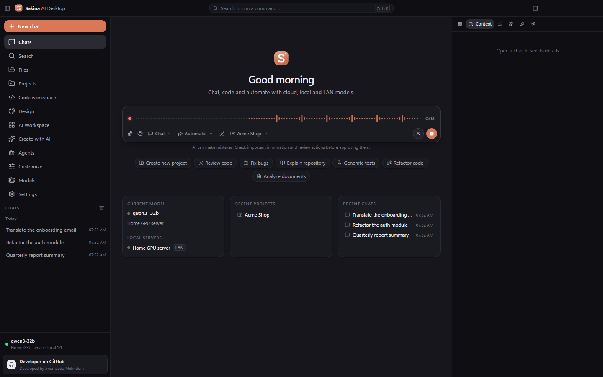
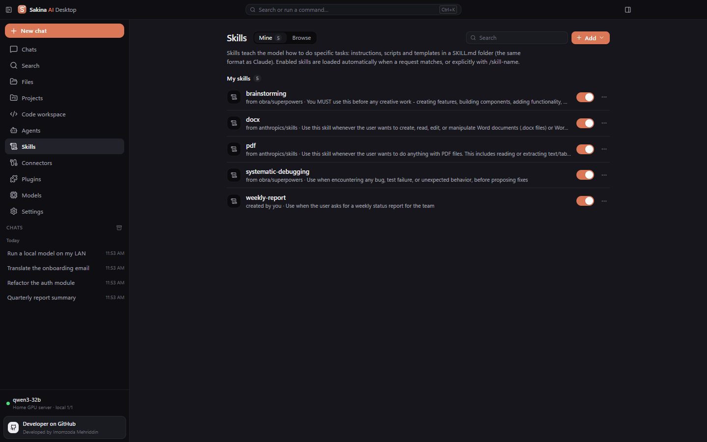
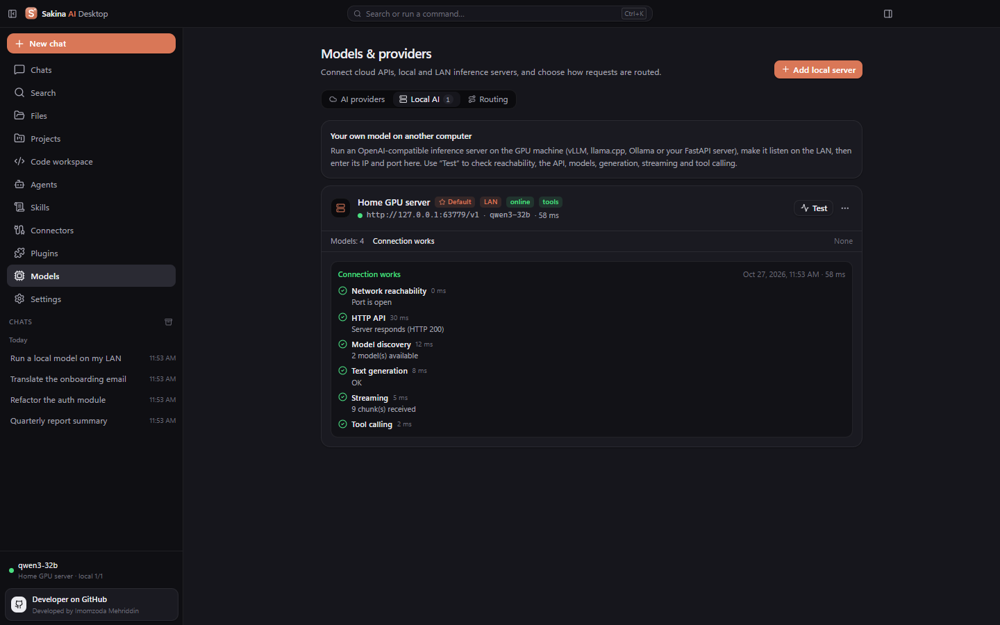
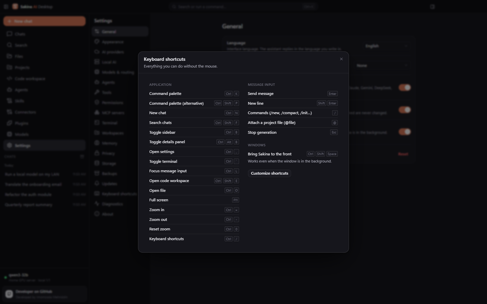
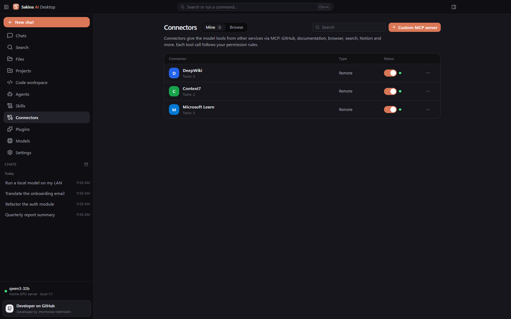

<div align="center">


# Sakina AI Desktop

**A professional desktop workspace for AI — cloud models, your own local and LAN models, an agent that works with your files and terminal, an AI Workspace you change by talking to it, Design, Skills, Connectors and Plugins.**

[](https://github.com/imomzoda-dev/SakinaAiDesktop/releases/latest)
[](https://github.com/imomzoda-dev/SakinaAiDesktop/releases)


[-6b7280)](LICENSE.md)

[**⬇ Download for Windows**](https://github.com/imomzoda-dev/SakinaAiDesktop/releases/latest) · [Changelog](CHANGELOG.md) · [Русский](README.ru.md)


</div>

---

## ✨ New in 1.1.9

- **Access switcher next to the mode**, like Claude Code: *Manual*, *Accept edits*, *Read only* and *Custom rules* — keys 1–4 pick one in the open menu. Risky actions and anything outside the project still always ask.
- **Command and skill suggestions** (`/…`, `@…`) redesigned: one-line names, descriptions underneath, scrolling and key hints.
- **Check for updates** is now on *Settings → Updates* too, with download progress and *Restart and update*; the update card's buttons no longer overflow a narrow sidebar.

## ✨ New in 1.1.8

- **Fixed: Design generation stopped at 94–95 % with "Generation cancelled".** Large decks are no longer cut off by a total time limit; a request stops only when the model sends nothing for a while, a timeout is a clear error with *Retry* (never "cancelled"), temporary overloads are retried automatically (*attempt 2 of 3*), and a fully received design is kept even if the connection drops at the end.
- Provider timeouts are now **inactivity timeouts** everywhere — long chat and agent answers keep streaming as long as the model writes.
- Gemini's **503 "high demand"** is shown as a clear "model overloaded (temporary)" message and retried automatically.

## ✨ New in 1.1.7



- **Voice input**, like ChatGPT and Claude: a microphone button next to *Send*. While you speak the box shows a live waveform and a timer; *Stop* (or Enter) turns your speech into text at the cursor — send it right away or edit it first. ✕ or Esc cancels; **Ctrl+Shift+M** starts and finishes dictation.
- Transcription uses your own providers — Whisper-compatible APIs (OpenAI, Groq, local Whisper servers) or Gemini. Provider, model and spoken language (auto, Russian, English, Tajik) are in *Settings → General → Voice input*. Recordings go only to that provider and are never stored; *Local only* mode keeps them on your local servers.
- **Clear quota errors**: Google's long quota reports become one readable line; a model with no quota on your plan (*limit: 0*) is reported as such, and the connection test finds a model that works.

## ✨ New in 1.1.6


- **Export decks to PowerPoint (.pptx).** Every slide keeps its artwork (backgrounds, charts, cards — as a 2× picture) and all text becomes native, **editable PowerPoint text boxes** with the same lines, fonts, sizes, colours and alignment. Opens cleanly in PowerPoint; about 90 KB per slide.
- **Tajik interface** proofread end to end — grammar, consistent terminology, translated Git commands; dates and numbers now use Tajik formatting.
- **Command palette** (Ctrl+K): *New presentation…*, *New design…*, *Create with AI*, Design and AI Workspace.
- **Design in the background** can be cancelled; the dock's *Open* button now expands the running job on any page (it used to make the card disappear).

| | |
|---|---|
|  |  |
| **Rendered by PowerPoint** — the exported .pptx, text editable | **The same deck in Sakina** |

## ✨ New in 1.1.5


- **Customize** — Skills, Connectors and Plugins in one place, like Claude: section switch, Mine / Browse, search, filter and **Add**; featured collections, "most popular" and category sections, cards with real service logos, verified developers and sign-in type, a details window with the server's tools.
- **58 connectors** (was 19): Linear, Atlassian (Jira, Confluence), Asana, monday.com, ClickUp, Slack, Zapier, Canva, Miro, Webflow, Wix, Vercel, Cloudflare, Stripe, PayPal, Square, Neon, Prisma Postgres, MongoDB, Airtable, HubSpot, PostHog, Perplexity and more — every endpoint and package checked. Account-based services connect in one click with sign-in in your browser.
- **Import MCP servers** from Claude Desktop or by pasting a JSON config (Cursor, VS Code) — imported servers start disabled, secrets are stored encrypted.
- **Design in the background** — a live progress bar with stages; **Minimize to background** turns the window into a compact indicator at the top right while you keep working, and tells you when the design is ready.
- **Smart code editor** — IntelliSense like VS Code for Python, Go, Rust, Java, C#, C/C++, PHP, Ruby, Kotlin, Dart, SQL and shells: type `pri` → `print`, signatures, docs, snippets, module members, your own functions and classes, parameter hints. **AI completion** suggests the next lines as grey text (Tab accepts).

| | |
|---|---|
|  |  |
| **Connector details** — developer, sign-in, tools | **Code editor** — IntelliSense and AI completion |
|  |  |
| **Design** — live progress with stages | **Background generation** — keep working, get notified |

## ✨ New in 1.1.4


- **AI Workspace (generative UI).** Change the app in plain words — *"Add a calendar on the right in Liquid Glass style"*, *"Make it wider"*, *"Show CPU and GPU load"*, *"Undo that"*. The model plans declarative, validated operations; 12 working widgets (calendar, tasks, notes, calculator, clock, system & GPU monitor, model monitor, charts, KPI cards, tables, progress, custom), drag-and-drop between the right panel, the dashboard and floating panels, undo/redo with snapshots, export/import. Works with every connected model — local or cloud.
- **Safe AI-made widgets.** Generated code runs only in an isolated sandbox (own origin, strict CSP, no network, no Node.js, no IPC) after you review its permissions and approve it; every version can be rolled back.
- **Design** — like Claude Design: **Slides**, **Design**, **Design in codebase** (follows your project's tokens and stack) and **Design system**. Refine by text, keep every version, preview on desktop / tablet / phone, present full screen, export to **PowerPoint**, **PDF** or **HTML**.
- **A real code workspace.** Right-click any file or folder: new file/folder, rename, cut/copy/paste, duplicate, delete (restorable), copy path, reveal in Explorer, open in the default app. Built-in previews for **Word, Excel, PowerPoint**, images, PDF, audio and video.
- **232 Skills** — +132 professional programming & design skills (ui-ux-pro-max, Vercel, Emil Kowalski, Matt Pocock, wshobson/agents, GSAP, Supabase, Android, WordPress…), categories, sorting, one-click starter packs and updates from GitHub.
- **Downloads per version** in *Settings → Updates*, **Check for updates** in *About*, and iOS-style glass notifications.

| | |
|---|---|
|  |  |
| **Design** — slides, designs and design systems | **Slides** — refine by text, present, export to PDF |
|  |  |
| **Design** — versions and live preview | **Code workspace** — context menu and Excel preview |

## Downloads by version

| Version | Downloads |
|---|---|
| [v1.1.9](https://github.com/imomzoda-dev/SakinaAiDesktop/releases/tag/v1.1.9) | [](https://github.com/imomzoda-dev/SakinaAiDesktop/releases/tag/v1.1.9) |
| [v1.1.8](https://github.com/imomzoda-dev/SakinaAiDesktop/releases/tag/v1.1.8) | [](https://github.com/imomzoda-dev/SakinaAiDesktop/releases/tag/v1.1.8) |
| [v1.1.7](https://github.com/imomzoda-dev/SakinaAiDesktop/releases/tag/v1.1.7) | [](https://github.com/imomzoda-dev/SakinaAiDesktop/releases/tag/v1.1.7) |
| [v1.1.6](https://github.com/imomzoda-dev/SakinaAiDesktop/releases/tag/v1.1.6) | [](https://github.com/imomzoda-dev/SakinaAiDesktop/releases/tag/v1.1.6) |
| [v1.1.5](https://github.com/imomzoda-dev/SakinaAiDesktop/releases/tag/v1.1.5) | [](https://github.com/imomzoda-dev/SakinaAiDesktop/releases/tag/v1.1.5) |
| [v1.1.4](https://github.com/imomzoda-dev/SakinaAiDesktop/releases/tag/v1.1.4) | [](https://github.com/imomzoda-dev/SakinaAiDesktop/releases/tag/v1.1.4) |
| [v1.1.3](https://github.com/imomzoda-dev/SakinaAiDesktop/releases/tag/v1.1.3) | [](https://github.com/imomzoda-dev/SakinaAiDesktop/releases/tag/v1.1.3) |
| [v1.1.2](https://github.com/imomzoda-dev/SakinaAiDesktop/releases/tag/v1.1.2) | [](https://github.com/imomzoda-dev/SakinaAiDesktop/releases/tag/v1.1.2) |
| **All versions** | [](https://github.com/imomzoda-dev/SakinaAiDesktop/releases) |

Counters come live from GitHub; the app shows the same numbers in *Settings → Updates → Versions and downloads*.

## Why Sakina

- **Any model, one app.** OpenAI, Anthropic Claude, Google Gemini, OpenRouter, Groq, DeepSeek, Mistral, Moonshot Kimi and any OpenAI-compatible API — **plus your own models**: Ollama, Open WebUI, vLLM, SGLang, llama.cpp, LM Studio, Kimi K2 self-hosted and 20 more local/LAN servers.
- **Private by design.** No telemetry. Chats, projects and settings stay on your PC; API keys are encrypted with Windows DPAPI. Route sensitive projects to local models only.
- **An agent that really works.** Reads and edits files, runs commands in your terminal, uses Git — every risky action waits for your approval, and every step is visible in a timeline.
- **Claude-style extensibility.** Skills (SKILL.md), Connectors (MCP) and Plugins (Claude Code format) — install the most popular ones from GitHub in one click.
- **Updates itself.** New versions are found on GitHub Releases, downloaded with progress, verified (SHA-512) and installed with one click — your data stays.

## Features

| | |
|---|---|
| 💬 **Chat** | Streaming answers, Markdown, tables, code highlighting, Mermaid, HTML/SVG preview, reasoning ("thinking") blocks, attachments incl. PDF text, branching edits, search, export |
| 🧠 **Models & routing** | Cloud and local providers, multi-key rotation, live health of local servers, automatic default model, smart / privacy-first / local-only routing |
| 🖥️ **Local & LAN AI** | 28 server types with a 6-step connection test; detects Open WebUI / Ollama / OpenAI-compatible servers and fixes the address in one click |
| 🛠️ **Agent & code workspace** | File explorer, Monaco editor, PowerShell / CMD / Git Bash terminal, Git panel, task checklist, approvals for risky actions, undo of file changes |
| 🪄 **AI Workspace** | Widgets and dashboards created and changed from the chat, 12 built-in widgets, sandboxed custom widgets, drag-and-drop, undo/redo, snapshots, export/import |
| 🎨 **Design** | Slides, designs, designs in your codebase and design systems made by AI; versions, device preview, presentation mode, PDF / HTML export |
| ✨ **Skills** | Catalog of 232 popular skills in 13 categories (Anthropic, ui-ux-pro-max, Vercel, obra/superpowers, wshobson/agents…), starter packs, updates from GitHub, your own skills; used automatically or with `/skill-name` |
| 📄 **Any file** | Word, Excel, PowerPoint, PDF, images, audio and video open inside the app; explorer context menu with every file action |
| 🔌 **Connectors** | 58 verified MCP connectors (GitHub, Context7, DeepWiki, Microsoft Learn, Playwright, Notion, Brave Search, Supabase, Sentry…) — tokens stored encrypted |
| 🧩 **Plugins** | The official Anthropic marketplace (300+ plugins) and any GitHub marketplace in Claude Code format: skills, slash commands and connectors |
| 🧭 **Comfort** | Global hotkey `Ctrl+Shift+Space`, tray icon, command palette `Ctrl+K`, shortcuts `Ctrl+/`, drafts per chat, response styles, notifications, light/dark themes, collapsible sidebar |
| 🔒 **Safety** | Path guard, command risk analysis, permission rules, audit log, backups with SHA-256 verification, database copy before every schema upgrade |

## Screenshots

| | |
|---|---|
|  |  |
| **Welcome** — light theme | **Code workspace** — editor, terminal, AI agent |
|  |  |
| **Skills catalog** — 232 skills, categories and starter packs | **My skills** — enable, view, update, remove |
|  |  |
| **Plugins** — official Anthropic marketplace | **Connectors** — one-click MCP |
|  |  |
| **Local AI** — 6-step connection test | **Keyboard shortcuts** |
|  |  |
| **My connectors** — status and tools | **Three languages** — Русский shown |

## Download & install

1. Download **`Sakina-AI-Desktop-Setup-<version>.exe`** from the [latest release](https://github.com/imomzoda-dev/SakinaAiDesktop/releases/latest).
2. Run it and follow the wizard (install for you only or for all users, choose the folder).
3. Windows SmartScreen may warn because the installer is not code-signed yet: click **More info → Run anyway**.

**Requirements:** Windows 10 or 11 (x64), 4 GB RAM (8 GB+ recommended), ~500 MB of disk space. Node.js is needed only for local MCP connectors (npx).

### Updating

Sakina checks GitHub Releases at start and every 4 hours (can be turned off in *Settings → Updates*). When a new version appears, a card slides open in the sidebar: **GitHub** opens the release notes, **Update** downloads it with a progress bar, verifies its SHA-512 and offers **Restart and update**. Installing a newer installer manually works too — it shows **Update 1.x → 1.y** instead of *Install* and keeps your chats, projects, settings and keys.

| | | |
|---|---|---|
|  |  |  |
| **New version found** | **Downloading** | **Ready to restart** |

## Your own model on another computer

Run the model on the GPU machine, use it from your laptop:

```bash
# On the GPU PC (Ollama example): listen on the local network
setx OLLAMA_HOST 0.0.0.0
ollama serve
```

In Sakina: **Models → Local AI → Add local server**, pick the server type (Ollama, Open WebUI, vLLM, SGLang, LM Studio, Kimi K2…), enter the IP and press **Test**. If the address belongs to a different server (for example an Open WebUI page instead of its API), the test detects it and offers **Apply**.

## Privacy

- No telemetry, no accounts, no ads.
- Data lives in `%APPDATA%\sakina-ai-desktop` on your computer.
- Requests go only to the providers and connectors you configure; update checks contact GitHub.
- API keys and connector tokens are encrypted with Windows DPAPI and never written to logs or exports.

## FAQ

**Is it free?** Yes — Sakina AI Desktop is free to use for personal and commercial work under the [EULA](LICENSE.md). AI providers bill you according to their own prices.

**Do I need an internet connection?** Not with local models. Cloud providers, the skills/plugins catalogs and update checks need internet.

**Can the AI break the app by changing the interface?** No. The model only sends declarative operations that are validated before anything changes; generated code runs in an isolated sandbox and only after your approval; every change can be undone.

**Can I use Claude Code skills and plugins?** Yes: Skills use the same `SKILL.md` format, and plugins in Claude Code format contribute their skills, slash commands and MCP servers. Subagents and hooks are listed but not executed.

## License

Sakina AI Desktop is proprietary freeware — see the [End User License Agreement](LICENSE.md). Open-source components are used under their own licenses (included with the app).

## Author

Developed by **Imomzoda Mehriddin** · [github.com/imomzoda-dev](https://github.com/imomzoda-dev)

Found a bug or have an idea? [Open an issue](https://github.com/imomzoda-dev/SakinaAiDesktop/issues).
