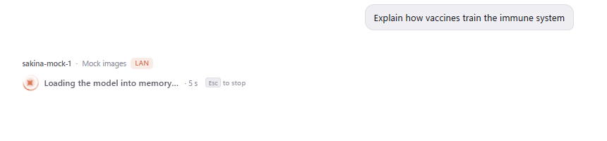
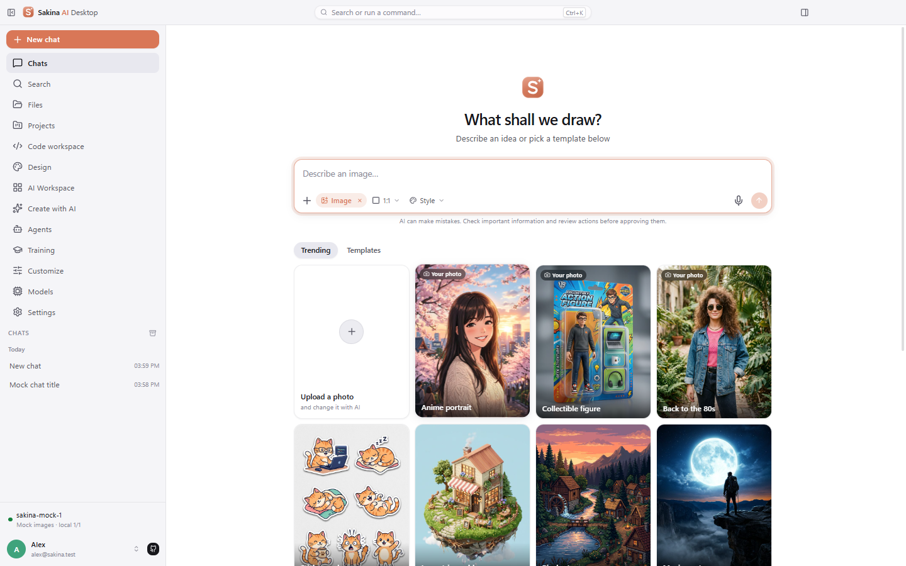
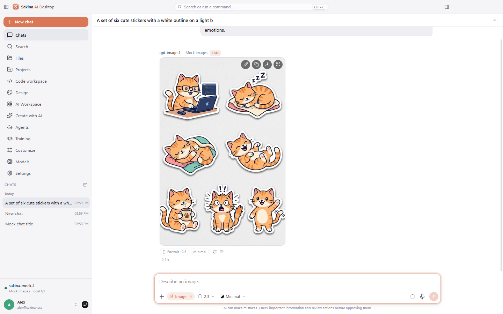
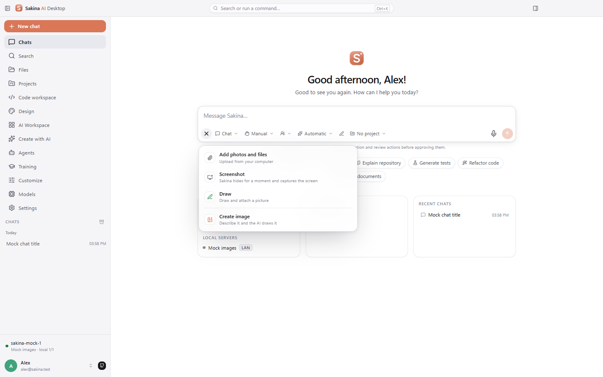
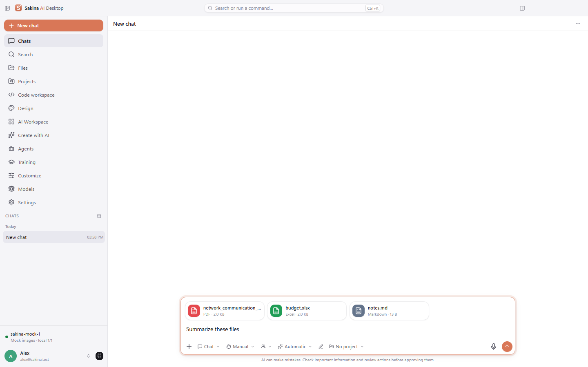
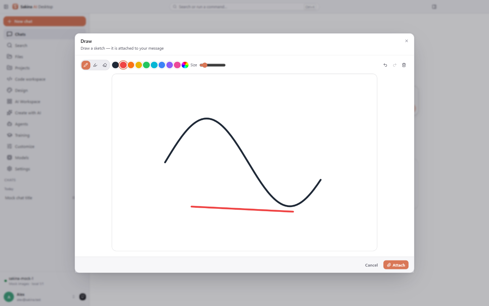
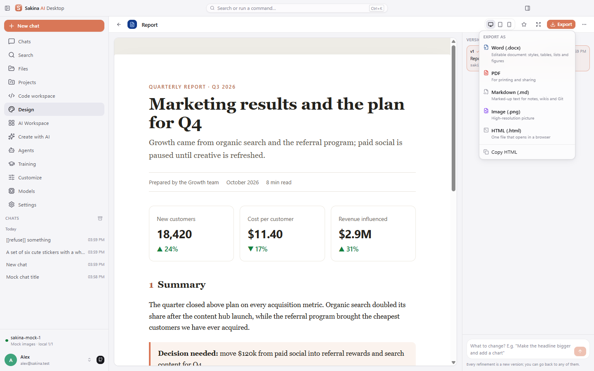

<div align="center">


# Sakina AI Desktop

**Ваше рабочее место с ИИ на Windows. Общайтесь с любой облачной или локальной моделью, доверьте агенту работу с кодом и терминалом, создавайте документы, презентации, дизайны и дашборды — а данные остаются на вашем компьютере.**

[](https://github.com/imomzoda-dev/SakinaAiDesktop/releases/latest)
[](https://github.com/imomzoda-dev/SakinaAiDesktop/releases)


[-6b7280)](LICENSE.md)

[**⬇ Скачать Sakina 1.3.8 для Windows**](https://github.com/imomzoda-dev/SakinaAiDesktop/releases/latest) · [Что нового](#-что-нового-в-138) · [Журнал изменений](CHANGELOG.md) · [English](README.md)


</div>

---

## ✨ Что нового в 1.3.8

- **Видно, как работает ИИ.** Вместо мигающего курсора — живая «искра» и строка состояния, которая говорит, что происходит прямо сейчас: «Думаю…», «Читаю вложения…», «Загружаю модель в память…», «Ищу в интернете: github.com…», «Читаю app.py…», «Выполняю команду npm test…», «Анализирую результат…» — со временем ожидания и подсказкой `Esc` — остановить. Как только ответ начинает печататься, его место занимает текст.

<p align="center">
  
</p>

- **Создание изображений прямо в чате.** Выберите «Создать изображение» в новой карточке **+** или шаблон, опишите картинку — её нарисует ваш провайдер: OpenAI GPT Image, Google Gemini («Nano Banana») и Imagen, OpenRouter, Together FLUX или LocalAI. Формат (квадрат, альбомный, портретный, широкий, вертикальный) и стиль (фото, аниме, 3D, акварель, масло, пиксель-арт, карандаш, комикс, пластилин, неон, минимализм). Пока изображение создаётся, рамка нужного формата плавно «проявляется»; готовая картинка появляется мягко.
- **Работа с изображением:** «Изменить» (картинка становится образцом — просто напишите «сделай ночь»), «Другой вариант», копирование, скачивание и просмотр на весь экран с масштабом, перетаскиванием и стрелками. Прикрепите своё фото и превратите его в аниме-портрет, коллекционную фигурку или фото товара.
- **«В тренде» и «Шаблоны»**, как в ChatGPT: 12 популярных идей с примерами, созданными ИИ, и 12 практичных шаблонов (обложка YouTube, пост для Instagram, обои, логотип, иконка приложения, открытка, аватар, интерьер, фото еды, тату, раскраска). Шаблон подставляет описание с выделенной частью для замены, формат и стиль; шаблоны «Ваше фото» сначала просят фото.
- **Новая карточка + в поле ввода:** фото и файлы, снимок экрана (Sakina на мгновение скрывается), рисунок (кисть, маркер, ластик, цвета, отмена), создание изображения, файл проекта и полоска недавних изображений.
- **Красивые вложения:** у каждого файла своя цветная иконка (PDF, Word, Excel, PowerPoint, CSV, архивы, код, аудио, видео, Markdown…), название и «тип · размер»; изображения показываются миниатюрами. Исправлено: первый файл, прикреплённый на стартовом экране, иногда не появлялся.
- **Экспорт под каждый тип «Дизайна»:** документы — в **Word (.docx)** с настоящими стилями Word (заголовки для навигации, списки, таблицы со строкой заголовка, цитаты, код, рисунки с подписями, номера страниц), PDF, Markdown, PNG и HTML; дашборды — в **Excel (.xlsx)** с данными и таблицами по листам; дизайн-системы — в **токены CSS и JSON** (светлая и тёмная темы); интерфейсы — **исходники** (.zip: HTML, CSS и JS).

<p align="center">
  
  
</p>
<p align="center">
  
  
</p>
<p align="center">
  
  
</p>

<p align="center">
  
  
</p>
<p align="center">
  
</p>

<p align="center">
  
  
</p>
<p align="center">
  
  
</p>
<p align="center">
  
  
</p>

## Почему Sakina

- **Любая модель в одном приложении.** OpenAI, Anthropic Claude, Google Gemini, OpenRouter, Groq, DeepSeek, Mistral, Moonshot Kimi и любой OpenAI-совместимый API — **а также ваши модели**: Ollama, Open WebUI, vLLM, SGLang, llama.cpp, LM Studio, Kimi K2 и другие локальные и сетевые серверы.
- **Приватность по умолчанию.** Никакой телеметрии. Чаты, проекты, файлы, дизайны и API-ключи остаются на компьютере; ключи шифруются Windows DPAPI. Чувствительные проекты можно направлять только в локальные модели.
- **Агент, который действительно работает.** Читает и правит файлы, запускает команды в терминале, работает с Git, задаёт вопросы и запускает субагентов — каждое рискованное действие ждёт вашего подтверждения, а любое изменение можно откатить.
- **Не только чат, но и создание.** Документы, презентации, интерфейсы, дашборды и дизайн-системы: доработка текстом, версии, экспорт в PDF, PowerPoint, PNG или HTML.
- **Расширения в стиле Claude.** Skills (`SKILL.md`), коннекторы (MCP), плагины и агенты в формате Claude Code — популярные ставятся с GitHub в один клик.
- **Обновляется сама.** Новые версии находятся в GitHub Releases, скачиваются с прогрессом, проверяются (SHA-512) и устанавливаются в один клик — данные сохраняются.

## Коротко о главном

### Чат

Потоковые ответы с Markdown, таблицами, кодом, Mermaid и предпросмотром HTML, блоки рассуждений, живой индикатор того, что делает ИИ, вложения (PDF, Office, изображения), голосовой ввод, ветвление правок и поиск. Sakina обращается к вам по имени и помнит черновики.

<p align="center">
  
  
</p>

### Дизайн

Шесть видов работ: **Документ**, **Слайды**, **Дизайн**, **Дашборд**, **Дизайн в кодовой базе** (по токенам и компонентам вашего проекта) и **Дизайн-система**. Генерация идёт в фоне — сверните окно и работайте дальше: капсула показывает прогресс и открывает результат, когда он готов.

<p align="center">
  
  
</p>

### Рабочее место для кода

Проводник, редактор Monaco с подсказками, быстрый переход Ctrl+P, задачи проекта, фоновые процессы, терминал (PowerShell, CMD, Git Bash), Git и панель ИИ, которую можно свернуть в тонкую полосу (`Ctrl+Alt+B`). Агент работает с контрольными точками, хуками, субагентами и вопросами.


### Пространство ИИ

Личный дашборд, который меняется по вашей просьбе: календарь, задачи, мониторы системы и модели, графики, показатели и ваши собственные виджеты в песочнице — с отменой, снимками и экспортом.


### Агенты и Обучение

Создавайте специализированных агентов (или набросайте их с помощью ИИ), выбирайте из каталога открытых агентов и обучайте свою модель: соберите модель Ollama из курса или своих данных, сравните её с базовой или получите набор LoRA под вашу видеокарту.

<p align="center">
  
  
</p>

### Skills, коннекторы и плагины

Каталог из 232 популярных навыков в 13 категориях, 58 проверенных MCP-коннекторов (GitHub, Context7, Notion, Playwright, Supabase…) и официальный маркетплейс плагинов Anthropic — установка в один клик, токены хранятся в зашифрованном виде.

<p align="center">
  
  
</p>

### Модели, аккаунт и «О программе»

Подключайте облачных провайдеров и свои серверы в локальной сети с проверкой в 6 шагов. Аккаунт Sakina хранит ваше имя и настройку на всех компьютерах; страница «О программе» показывает версию, репозиторий GitHub и вашу активность.

<p align="center">
  
  
</p>

## Все возможности

| | |
|---|---|
| 💬 **Чат** | Потоковые ответы, Markdown, таблицы, подсветка кода, Mermaid, предпросмотр HTML/SVG, блоки рассуждений, вложения (PDF и Office) с иконками типов файлов, снимки экрана и рисунки, голосовой ввод, ветвление правок, поиск, экспорт, стили ответов, слэш-команды |
| 🖼️ **Изображения** | Создание и правка изображений через GPT Image, Gemini / Imagen, OpenRouter, FLUX или LocalAI: форматы, 12 стилей, идеи в тренде и шаблоны, правка по образцу, просмотр на весь экран, сохранение и копирование |
| 🎨 **Дизайн** | Документы, слайды, дизайны, дашборды, дизайн в кодовой базе и дизайн-системы; галерея с живыми превью, версии, просмотр на устройствах, полный экран и показ с обзором слайдов, генерация в фоне; экспорт в Word / PowerPoint / Excel / PDF / Markdown / PNG / HTML, токены дизайна и исходники |
| 🛠️ **Код и агент** | Проводник, редактор Monaco, Ctrl+P, задачи, фоновые процессы, строка состояния, терминал, Git, сворачиваемая панель ИИ, субагенты, вопросы от агента, хуки, контрольные точки и откат, подтверждение рискованных действий |
| 🪄 **Пространство ИИ** | Виджеты и дашборды, которые создаются и меняются из чата, 12 встроенных виджетов, свои виджеты в песочнице, перетаскивание, отмена/повтор, снимки, экспорт/импорт |
| 🤖 **Агенты** | Свои агенты в формате субагентов Claude Code, черновик с помощью ИИ и каталог открытых агентов |
| 🎓 **Обучение** | Сборка моделей Ollama из курсов или своих данных, сравнение с базовой моделью, наборы LoRA с учётом видеокарты |
| 🧠 **Модели и маршрутизация** | Облачные и локальные провайдеры, несколько ключей, состояние локальных серверов, автоматическая модель по умолчанию, умная / приватная / только локальная маршрутизация |
| 🖥️ **Локальный и сетевой ИИ** | 28 типов серверов с проверкой подключения в 6 шагов; распознаёт Open WebUI / Ollama / OpenAI-совместимые серверы и исправляет адрес в один клик |
| ✨ **Skills, коннекторы, плагины** | 232 навыка, 58 MCP-коннекторов, официальный маркетплейс Anthropic и любой маркетплейс GitHub в формате Claude Code |
| 📄 **Любые файлы** | Word, Excel, PowerPoint, PDF, изображения, аудио и видео открываются прямо в приложении |
| 👤 **Аккаунт** | «Продолжить с Google» или вход по e-mail (подтверждение, сброс пароля, шкала надёжности), фото профиля с кадрированием, разовая настройка, профиль и имя на любом компьютере, полное удаление аккаунта |
| 🧭 **Удобство** | Глобальная клавиша `Ctrl+Shift+Space`, значок в трее, палитра команд `Ctrl+K`, сочетания клавиш `Ctrl+/`, светлая и тёмная темы, интерфейс на русском, английском и таджикском |
| 🔒 **Безопасность** | Защита путей, анализ риска команд, правила доступа, журнал аудита, зашифрованные секреты, резервные копии с проверкой SHA-256, копия базы перед каждым обновлением схемы |

## Установка

1. Скачайте **`Sakina-AI-Desktop-Setup-1.3.8.exe`** из [последнего релиза](https://github.com/imomzoda-dev/SakinaAiDesktop/releases/latest).
2. Запустите и следуйте мастеру (установка для себя или для всех пользователей, выбор папки).
3. Windows SmartScreen может предупредить, потому что установщик пока не подписан: нажмите **Подробнее → Выполнить в любом случае**.
4. Нажмите «Продолжить с Google» или создайте аккаунт по e-mail, один раз ответьте на короткую настройку — и можно работать.

**Требования:** Windows 10 или 11 (x64), 4 ГБ ОЗУ (рекомендуется 8 ГБ и больше), около 500 МБ на диске. Node.js нужен только для локальных MCP-коннекторов (npx).

### Обновление

Sakina проверяет GitHub Releases при запуске и каждые 4 часа (можно отключить в *Настройки → Обновления*). Когда выходит новая версия, в боковой панели появляется карточка: **Обновить** скачивает её с прогрессом, проверяет SHA-512 и предлагает **Перезапустить и обновить**. Можно и просто запустить новый установщик — чаты, проекты, дизайны, настройки и ключи сохранятся.

## Своя модель на другом компьютере

Запустите модель на компьютере с видеокартой и пользуйтесь ею с ноутбука:

```bash
# На компьютере с GPU (пример для Ollama): слушать локальную сеть
setx OLLAMA_HOST 0.0.0.0
ollama serve
```

В Sakina: **Модели → Локальный ИИ → Добавить локальный сервер**, выберите тип сервера (Ollama, Open WebUI, vLLM, SGLang, LM Studio, Kimi K2…), введите IP и нажмите **Проверить**. Если по адресу отвечает другой сервер (например, страница Open WebUI вместо его API), проверка это заметит и предложит **Применить**.

## Приватность

- Никакой телеметрии и рекламы.
- Чаты, файлы, проекты, дизайны и настройки хранятся в `%APPDATA%\sakina-ai-desktop` на вашем компьютере. История чатов никуда не отправляется.
- Аккаунт Sakina хранит только e-mail, имя, фото (при входе через Google) и ответы на настройку; при входе через Google Sakina никогда не видит ваш пароль Google; удалить аккаунт со всеми данными можно в любой момент в *Настройки → Аккаунт*.
- Запросы уходят только к тем провайдерам ИИ и коннекторам, которые вы настроили; проверка обновлений обращается к GitHub.
- API-ключи, токены коннекторов и сессия входа шифруются Windows DPAPI и никогда не попадают в журналы и экспорт.

## Вопросы и ответы

**Это бесплатно?** Да — Sakina AI Desktop бесплатна для личного и коммерческого использования по [лицензии](LICENSE.md). Провайдеры ИИ берут оплату по своим тарифам.

**Нужен ли интернет?** Для локальных моделей — нет. Вход в аккаунт, облачные провайдеры, каталоги и проверка обновлений требуют интернета.

**Какую модель выбрать для дизайна?** Лучшие документы, презентации и дашборды получаются у сильной модели с большим лимитом ответа. Если длинный дизайн обрывается, увеличьте *Макс. токенов ответа* у модели в разделе *Модели*.

**Может ли ИИ сломать приложение, меняя интерфейс?** Нет. Модель присылает только декларативные операции, которые проверяются до любых изменений; сгенерированный код работает в изолированной песочнице; любое изменение можно отменить.

**Работают ли навыки, плагины и агенты Claude Code?** Да: навыки используют тот же формат `SKILL.md`, плагины добавляют свои навыки, слэш-команды и MCP-серверы, агенты — формат субагентов, а хуки работают по тем же правилам кодов выхода.

## Скачивания по версиям

| Версия | Скачивания |
|---|---|
| [v1.3.8](https://github.com/imomzoda-dev/SakinaAiDesktop/releases/tag/v1.3.8) | [](https://github.com/imomzoda-dev/SakinaAiDesktop/releases/tag/v1.3.8) |
| [v1.3.7](https://github.com/imomzoda-dev/SakinaAiDesktop/releases/tag/v1.3.7) | [](https://github.com/imomzoda-dev/SakinaAiDesktop/releases/tag/v1.3.7) |
| [v1.3.6](https://github.com/imomzoda-dev/SakinaAiDesktop/releases/tag/v1.3.6) | [](https://github.com/imomzoda-dev/SakinaAiDesktop/releases/tag/v1.3.6) |
| [v1.3.5](https://github.com/imomzoda-dev/SakinaAiDesktop/releases/tag/v1.3.5) | [](https://github.com/imomzoda-dev/SakinaAiDesktop/releases/tag/v1.3.5) |
| [v1.3.4](https://github.com/imomzoda-dev/SakinaAiDesktop/releases/tag/v1.3.4) | [](https://github.com/imomzoda-dev/SakinaAiDesktop/releases/tag/v1.3.4) |
| [v1.3.3](https://github.com/imomzoda-dev/SakinaAiDesktop/releases/tag/v1.3.3) | [](https://github.com/imomzoda-dev/SakinaAiDesktop/releases/tag/v1.3.3) |
| **Все версии** | [](https://github.com/imomzoda-dev/SakinaAiDesktop/releases) |

Счётчики берутся с GitHub в реальном времени; те же числа есть в программе в *Настройки → О программе* и *Настройки → Обновления*.

## Лицензия

Sakina AI Desktop — проприетарная бесплатная программа, см. [лицензионное соглашение](LICENSE.md). Компоненты с открытым исходным кодом используются по их собственным лицензиям (прилагаются к программе).

## Автор

Разработчик — **Imomzoda Mehriddin** · [github.com/imomzoda-dev](https://github.com/imomzoda-dev)

Нашли ошибку или есть идея? [Создайте issue](https://github.com/imomzoda-dev/SakinaAiDesktop/issues).
