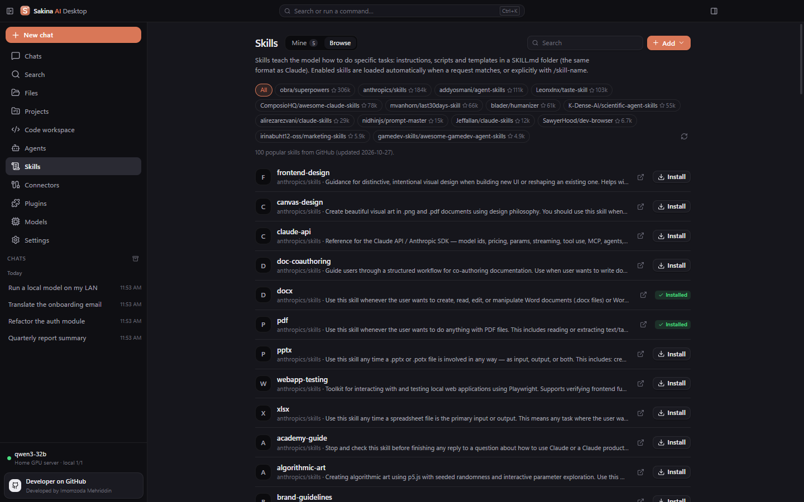

<div align="center">


# Sakina AI Desktop

**Профессиональное рабочее пространство для ИИ на компьютере — облачные модели, свои локальные и сетевые модели, агент, который работает с файлами и терминалом, Skills, Коннекторы и Плагины.**

[](https://github.com/imomzoda-dev/SakinaAiDesktop/releases/latest)
[](https://github.com/imomzoda-dev/SakinaAiDesktop/releases)

[-6b7280)](LICENSE.md)

[**⬇ Скачать для Windows**](https://github.com/imomzoda-dev/SakinaAiDesktop/releases/latest) · [Журнал изменений](CHANGELOG.md) · [English](README.md)


</div>

---

## Почему Sakina

- **Любая модель в одном приложении.** OpenAI, Anthropic Claude, Google Gemini, OpenRouter, Groq, DeepSeek, Mistral, Moonshot Kimi и любой OpenAI-совместимый API — **и ваши собственные модели**: Ollama, Open WebUI, vLLM, SGLang, llama.cpp, LM Studio, Kimi K2 (своя установка) и ещё 20 типов локальных и сетевых серверов.
- **Приватность.** Никакой телеметрии. Чаты, проекты и настройки хранятся на вашем компьютере, ключи API зашифрованы Windows DPAPI. Конфиденциальные проекты можно направлять только на локальные модели.
- **Агент, который действительно работает.** Читает и правит файлы, запускает команды в терминале, работает с Git — каждое рискованное действие ждёт вашего подтверждения, а каждый шаг виден на ленте.
- **Расширяемость как в Claude.** Skills (SKILL.md), Коннекторы (MCP) и Плагины (формат Claude Code) — самые популярные устанавливаются с GitHub в один клик.
- **Обновляется сама.** Новая версия находится на GitHub Releases, скачивается с прогрессом, проверяется (SHA-512) и устанавливается одной кнопкой — данные сохраняются.

## Возможности

| | |
|---|---|
| 💬 **Чат** | Потоковые ответы, Markdown, таблицы, подсветка кода, Mermaid, предпросмотр HTML/SVG, блок «Размышления», вложения (включая текст PDF), ветвление, поиск, экспорт |
| 🧠 **Модели и маршрутизация** | Облачные и локальные провайдеры, несколько ключей с чередованием, живой статус локальных серверов, автоматическая модель по умолчанию, умная маршрутизация и режим «только локально» |
| 🖥️ **Локальный ИИ и сеть** | 28 типов серверов и проверка подключения из 6 шагов; автоматически распознаёт Open WebUI, Ollama и OpenAI-совместимые серверы и исправляет адрес одной кнопкой |
| 🛠️ **Агент и рабочее место** | Проводник, редактор Monaco, терминал PowerShell / CMD / Git Bash, Git, список задач агента, подтверждение рискованных действий, откат изменений файлов |
| ✨ **Skills** | Каталог из 100 популярных навыков (Anthropic, obra/superpowers, addyosmani/agent-skills…), создание своих, импорт из папки, .zip или GitHub; применяются автоматически или командой `/имя` |
| 🔌 **Коннекторы** | 19 проверенных MCP-коннекторов (GitHub, Context7, DeepWiki, Microsoft Learn, Playwright, Notion, Brave Search, Supabase, Sentry…) — токены хранятся зашифрованными |
| 🧩 **Плагины** | Официальный маркетплейс Anthropic (300+ плагинов) и любые маркетплейсы GitHub в формате Claude Code: навыки, slash-команды и коннекторы |
| 🧭 **Удобство** | Глобальная клавиша `Ctrl+Shift+Space`, значок в трее, палитра команд `Ctrl+K`, справка `Ctrl+/`, черновики, стили ответа, уведомления, светлая и тёмная темы, сворачиваемый сайдбар |
| 🔒 **Безопасность** | Защита путей, анализ риска команд, правила разрешений, журнал аудита, резервные копии с проверкой SHA-256, копия базы перед каждым обновлением схемы |

## Скриншоты

| | |
|---|---|
|  |  |
| **Главный экран** — светлая тема | **Рабочее место** — редактор, терминал, ИИ-агент |
|  |  |
| **Каталог навыков** | **Плагины** — маркетплейс Anthropic |
|  |  |
| **Коннекторы** — MCP в один клик | **Три языка** — русский, английский, таджикский |

## Установка

1. Скачайте **`Sakina-AI-Desktop-Setup-<версия>.exe`** из [последнего релиза](https://github.com/imomzoda-dev/SakinaAiDesktop/releases/latest).
2. Запустите и следуйте мастеру (установка для себя или для всех пользователей, выбор папки).
3. Windows SmartScreen может предупредить, потому что установщик пока не подписан сертификатом: нажмите **Подробнее → Выполнить в любом случае**.

**Требования:** Windows 10 или 11 (x64), 4 ГБ ОЗУ (рекомендуется от 8 ГБ), около 500 МБ на диске. Node.js нужен только для локальных MCP-коннекторов (npx).

### Обновление

Sakina проверяет GitHub Releases при запуске и каждые 4 часа (отключается в *Настройки → Обновления*). Когда выходит новая версия, в сайдбаре плавно появляется карточка: **GitHub** открывает описание релиза, **Обновить** скачивает его с прогрессом, проверяет SHA-512 и предлагает **Перезапустить и обновить**. Можно обновиться и вручную — новый установщик покажет «Обновление 1.x → 1.y» вместо «Установить» и сохранит чаты, проекты, настройки и ключи.

## Своя модель на другом компьютере

```bash
# На компьютере с видеокартой (пример для Ollama): слушать локальную сеть
setx OLLAMA_HOST 0.0.0.0
ollama serve
```

В Sakina: **Модели → Локальный ИИ → Добавить локальный сервер**, выберите тип (Ollama, Open WebUI, vLLM, SGLang, LM Studio, Kimi K2…), укажите IP и нажмите **Проверить**. Если по адресу работает другой сервер (например, страница Open WebUI вместо её API), проверка это распознает и предложит **Применить**.

## Приватность

- Без телеметрии, аккаунтов и рекламы.
- Данные хранятся в `%APPDATA%\sakina-ai-desktop` на вашем компьютере.
- Запросы уходят только выбранным вами провайдерам и коннекторам; проверка обновлений обращается к GitHub.
- Ключи API и токены коннекторов зашифрованы Windows DPAPI и не попадают в журналы и экспорт.

## Лицензия

Sakina AI Desktop — бесплатная проприетарная программа, см. [лицензионное соглашение](LICENSE.md). Компоненты с открытым кодом используются по их собственным лицензиям (они включены в программу).

## Автор

Разработчик — **Imomzoda Mehriddin** · [github.com/imomzoda-dev](https://github.com/imomzoda-dev)

Нашли ошибку или есть идея? [Создайте issue](https://github.com/imomzoda-dev/SakinaAiDesktop/issues).
