<div align="center">


# Sakina AI Desktop

**Профессиональное рабочее пространство для ИИ на компьютере — облачные модели, свои локальные и сетевые модели, агент, который работает с файлами и терминалом, Пространство ИИ, которое меняется по вашей просьбе, Design, Skills, Коннекторы и Плагины.**

[](https://github.com/imomzoda-dev/SakinaAiDesktop/releases/latest)
[](https://github.com/imomzoda-dev/SakinaAiDesktop/releases)

[-6b7280)](LICENSE.md)

[**⬇ Скачать для Windows**](https://github.com/imomzoda-dev/SakinaAiDesktop/releases/latest) · [Журнал изменений](CHANGELOG.md) · [English](README.md)

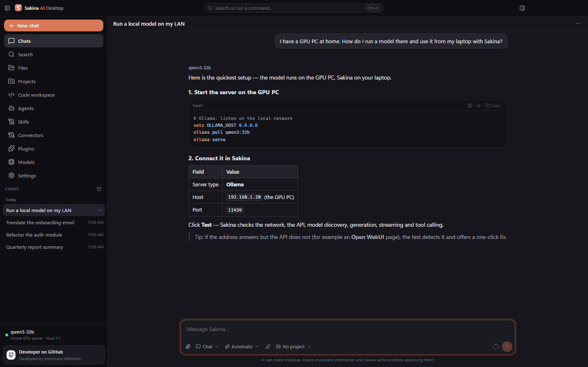

</div>

---

## ✨ Новое в 1.1.6

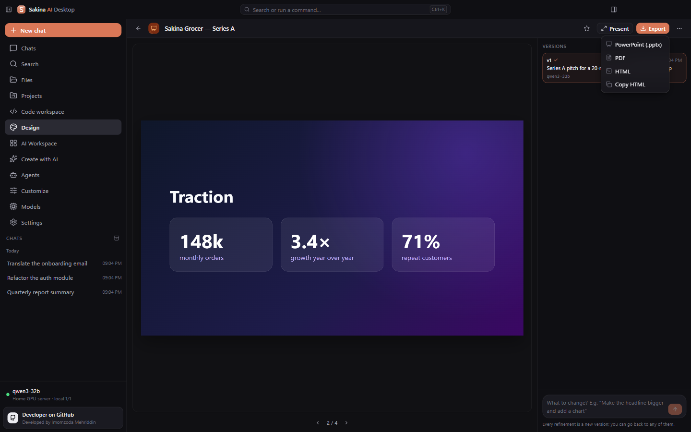

- **Экспорт презентаций в PowerPoint (.pptx).** Оформление каждого слайда (фоны, графики, карточки) сохраняется картинкой в двойном разрешении, а весь текст становится настоящими **редактируемыми полями PowerPoint** с теми же строками, шрифтами, размерами, цветами и выравниванием. Файл открывается в PowerPoint без предупреждений, около 90 КБ на слайд.
- **Таджикский интерфейс** полностью вычитан — грамматика, единые термины, команды Git на таджикском; даты и числа в таджикском формате.
- **Палитра команд** (Ctrl+K): «Новая презентация…», «Новый дизайн…», «Создать с ИИ», Design и «Пространство ИИ».
- **Design в фоне** можно отменить; кнопка «Открыть» в индикаторе теперь разворачивает идущую генерацию на любой странице (раньше карточка исчезала).

| | |
|---|---|
| 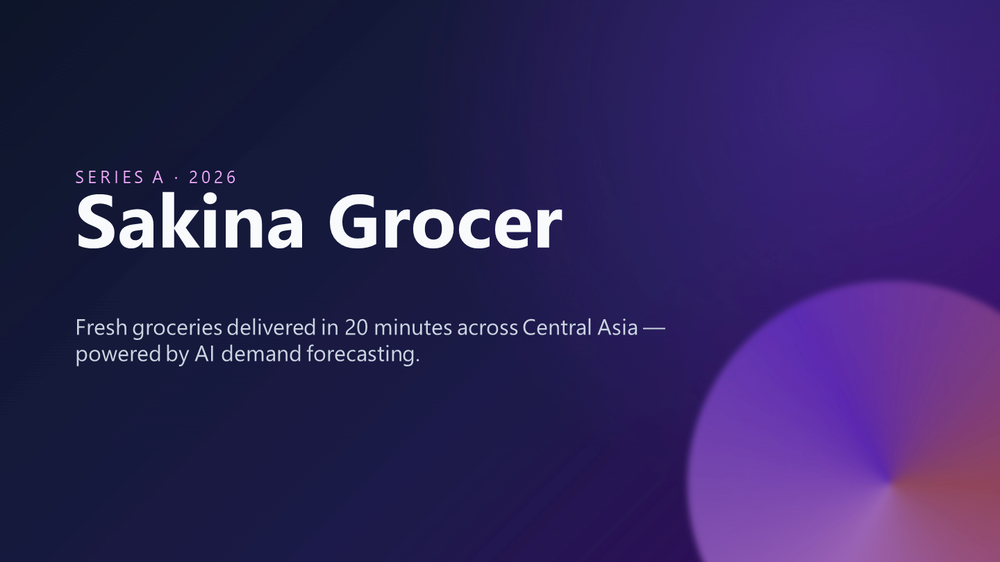 | 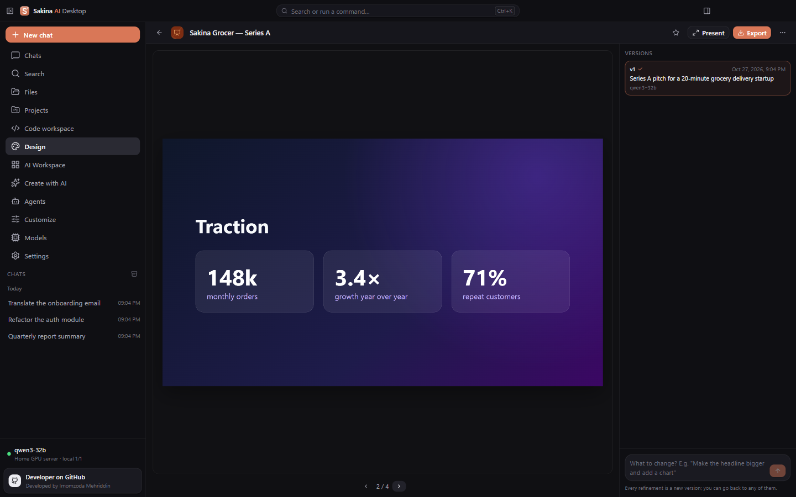 |
| **Так её показывает PowerPoint** — файл .pptx, текст редактируется | **Та же презентация в Sakina** |

## ✨ Новое в 1.1.5

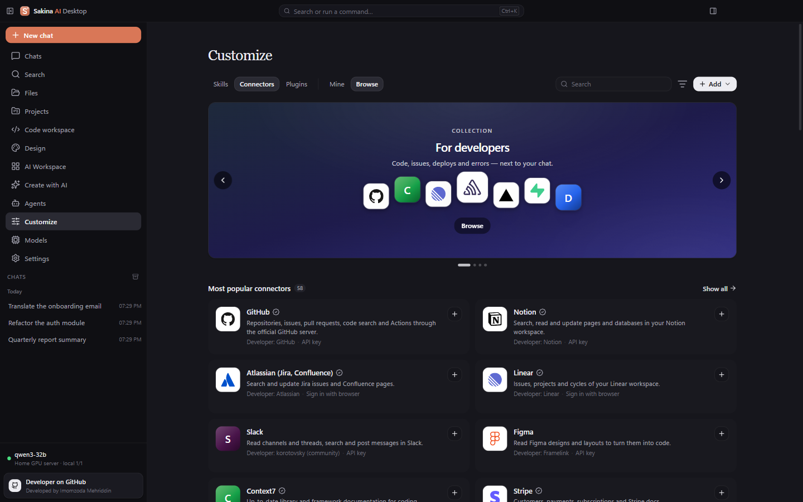

- **Персонализация** — Skills, Коннекторы и Плагины в одном разделе, как в Claude: переключатель разделов, «Мои / Обзор», поиск, фильтр и «Добавить»; подборки, «Самые популярные» и разделы по категориям, карточки с настоящими логотипами сервисов, отметкой официального разработчика и типом входа, окно подробностей с инструментами сервера.
- **58 коннекторов** (было 19): Linear, Atlassian (Jira, Confluence), Asana, monday.com, ClickUp, Slack, Zapier, Canva, Miro, Webflow, Wix, Vercel, Cloudflare, Stripe, PayPal, Square, Neon, Prisma Postgres, MongoDB, Airtable, HubSpot, PostHog, Perplexity и другие — каждый адрес и пакет проверен. Сервисы с аккаунтом подключаются в один клик со входом в браузере.
- **Импорт MCP-серверов** из Claude Desktop или вставкой JSON-конфигурации (Cursor, VS Code) — импортированные серверы создаются выключенными, ключи хранятся зашифрованными.
- **Design в фоне** — живой прогресс с этапами; кнопка **«Свернуть в фон»** превращает окно в компактный индикатор справа сверху, пока вы работаете дальше, и сообщает, когда дизайн готов.
- **Умный редактор кода** — подсказки как в VS Code для Python, Go, Rust, Java, C#, C/C++, PHP, Ruby, Kotlin, Dart, SQL и командных оболочек: набрали `pri` → `print`, подписи, описания, сниппеты, члены модулей, ваши функции и классы, подсказки параметров. **ИИ-дополнение** предлагает следующие строки серым текстом (Tab — принять).

| | |
|---|---|
| 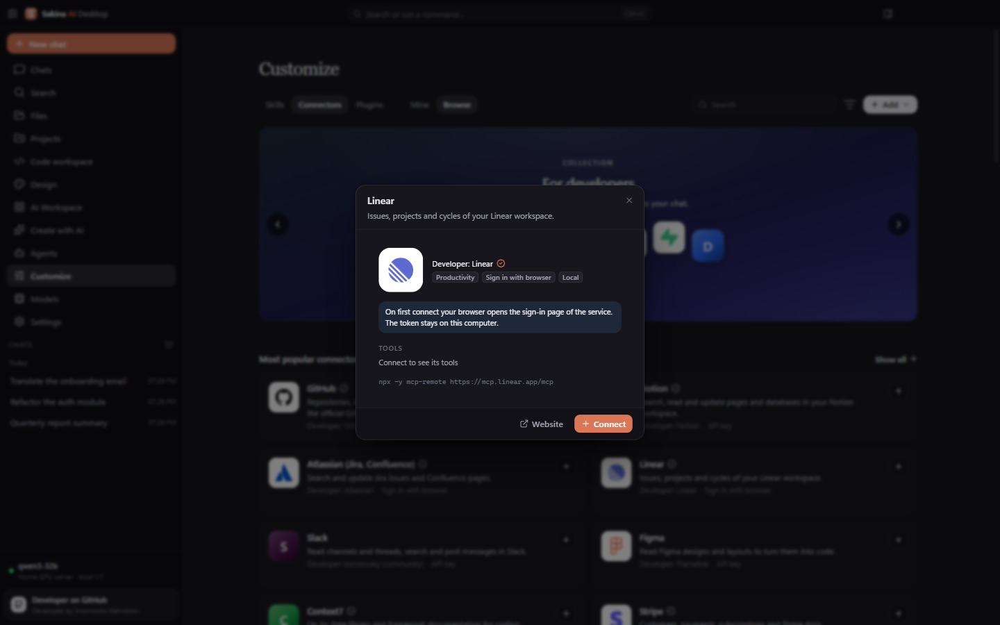 | 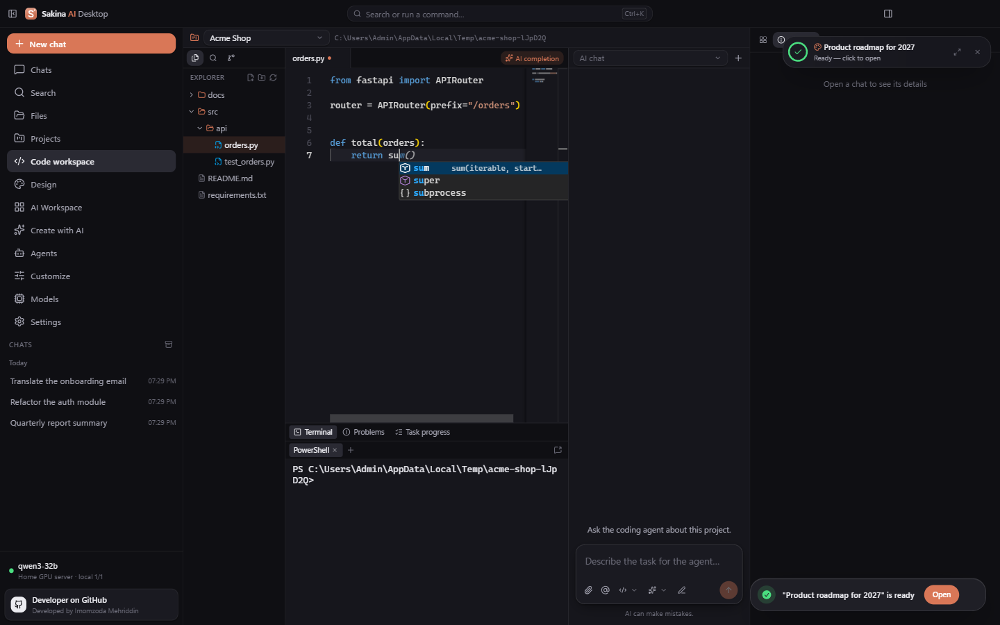 |
| **Подробности коннектора** — разработчик, вход, инструменты | **Редактор кода** — подсказки и ИИ-дополнение |
| 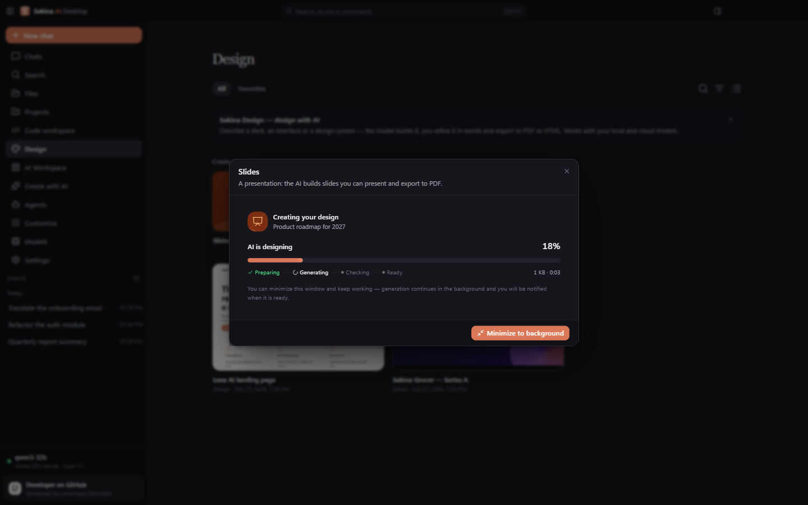 |  |
| **Design** — живой прогресс с этапами | **Фоновая генерация** — работайте дальше и получите уведомление |

## ✨ Новое в 1.1.4

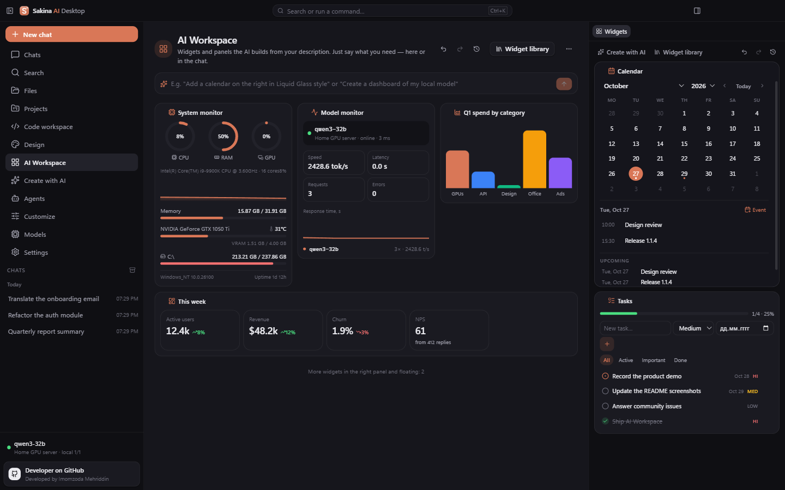

- **Пространство ИИ (Generative UI).** Меняйте программу обычными словами — *«Добавь календарь справа в стиле Liquid Glass»*, *«Сделай его шире»*, *«Покажи загрузку процессора и видеокарты»*, *«Верни как было»*. Модель составляет декларативные проверяемые операции; 12 рабочих виджетов (календарь, задачи, заметки, калькулятор, часы, монитор системы и GPU, монитор модели, графики, KPI-карточки, таблицы, прогресс, свои), перетаскивание между правой панелью, дашбордом и плавающими панелями, отмена/повтор со снимками, экспорт и импорт. Работает с любой подключённой моделью — локальной или облачной.
- **Безопасные виджеты от ИИ.** Сгенерированный код выполняется только в изолированной песочнице (свой источник, строгий CSP, без сети, Node.js и IPC) после того, как вы проверите разрешения и подтвердите установку; любую версию можно откатить.
- **Design** — как Claude Design: **Слайды**, **Дизайн**, **Дизайн в кодовой базе** (учитывает токены и стек вашего проекта) и **Дизайн-система**. Доработка текстом, история версий, предпросмотр на компьютере / планшете / телефоне, показ на весь экран, экспорт в **PowerPoint**, **PDF** и **HTML**.
- **Настоящее рабочее место.** Правый клик по файлу или папке: новый файл/папка, переименование, вырезать/копировать/вставить, дублировать, удалить (с восстановлением), копировать путь, показать в проводнике, открыть в программе по умолчанию. Встроенный просмотр **Word, Excel, PowerPoint**, изображений, PDF, аудио и видео.
- **232 навыка** — +132 профессиональных навыка для программирования и дизайна (ui-ux-pro-max, Vercel, Emil Kowalski, Matt Pocock, wshobson/agents, GSAP, Supabase, Android, WordPress…), категории, сортировка, готовые наборы в один клик и обновление с GitHub.
- **Число скачиваний каждой версии** в *Настройки → Обновления*, **проверка обновлений** в *О программе* и уведомления в стиле iOS.

| | |
|---|---|
| 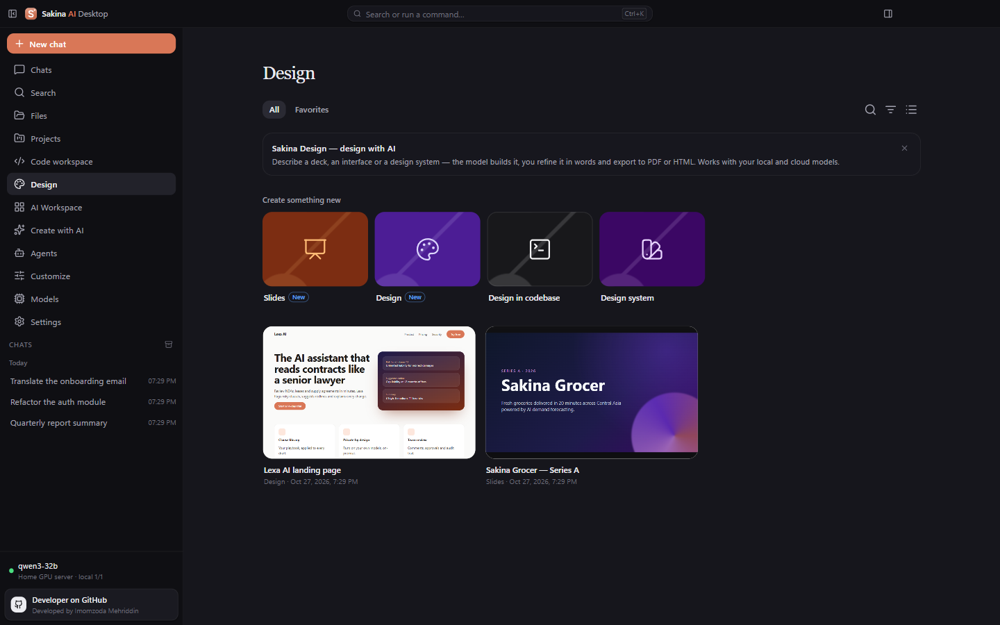 |  |
| **Design** — слайды, дизайны и дизайн-системы | **Слайды** — доработка текстом, показ, экспорт в PDF |
| 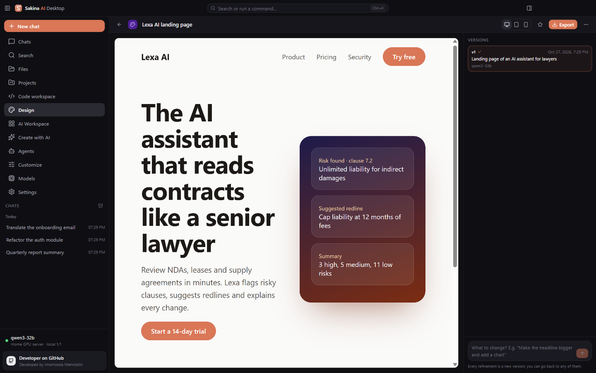 | 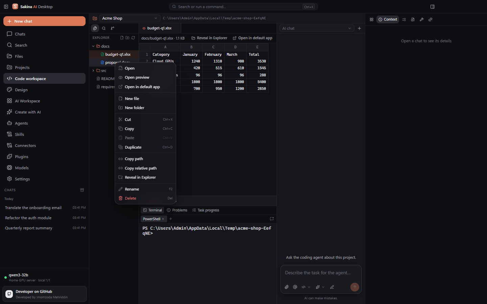 |
| **Design** — версии и живой предпросмотр | **Рабочее место** — контекстное меню и просмотр Excel |

## Скачивания по версиям

| Версия | Скачивания |
|---|---|
| [v1.1.6](https://github.com/imomzoda-dev/SakinaAiDesktop/releases/tag/v1.1.6) | [](https://github.com/imomzoda-dev/SakinaAiDesktop/releases/tag/v1.1.6) |
| [v1.1.5](https://github.com/imomzoda-dev/SakinaAiDesktop/releases/tag/v1.1.5) | [](https://github.com/imomzoda-dev/SakinaAiDesktop/releases/tag/v1.1.5) |
| [v1.1.4](https://github.com/imomzoda-dev/SakinaAiDesktop/releases/tag/v1.1.4) | [](https://github.com/imomzoda-dev/SakinaAiDesktop/releases/tag/v1.1.4) |
| [v1.1.3](https://github.com/imomzoda-dev/SakinaAiDesktop/releases/tag/v1.1.3) | [](https://github.com/imomzoda-dev/SakinaAiDesktop/releases/tag/v1.1.3) |
| [v1.1.2](https://github.com/imomzoda-dev/SakinaAiDesktop/releases/tag/v1.1.2) | [](https://github.com/imomzoda-dev/SakinaAiDesktop/releases/tag/v1.1.2) |
| **Все версии** | [](https://github.com/imomzoda-dev/SakinaAiDesktop/releases) |

Счётчики берутся с GitHub в реальном времени; те же числа показывает программа в *Настройки → Обновления → Версии и загрузки*.

## Почему Sakina

- **Любая модель в одном приложении.** OpenAI, Anthropic Claude, Google Gemini, OpenRouter, Groq, DeepSeek, Mistral, Moonshot Kimi и любой OpenAI-совместимый API — **и ваши собственные модели**: Ollama, Open WebUI, vLLM, SGLang, llama.cpp, LM Studio, Kimi K2 (своя установка) и ещё 20 типов локальных и сетевых серверов.
- **Приватность.** Никакой телеметрии. Чаты, проекты и настройки хранятся на вашем компьютере, ключи API зашифрованы Windows DPAPI. Конфиденциальные проекты можно направлять только на локальные модели.
- **Агент, который действительно работает.** Читает и правит файлы, запускает команды в терминале, работает с Git — каждое рискованное действие ждёт вашего подтверждения, а каждый шаг виден на ленте.
- **Расширяемость как в Claude.** Skills (SKILL.md), Коннекторы (MCP) и Плагины (формат Claude Code) — самые популярные устанавливаются с GitHub в один клик.
- **Обновляется сама.** Новая версия находится на GitHub Releases, скачивается с прогрессом, проверяется (SHA-512) и устанавливается одной кнопкой — данные сохраняются.

## Возможности

| | |
|---|---|
| 💬 **Чат** | Потоковые ответы, Markdown, таблицы, подсветка кода, Mermaid, предпросмотр HTML/SVG, блок «Размышления», вложения (включая текст PDF), ветвление, поиск, экспорт |
| 🧠 **Модели и маршрутизация** | Облачные и локальные провайдеры, несколько ключей с чередованием, живой статус локальных серверов, автоматическая модель по умолчанию, умная маршрутизация и режим «только локально» |
| 🖥️ **Локальный ИИ и сеть** | 28 типов серверов и проверка подключения из 6 шагов; автоматически распознаёт Open WebUI, Ollama и OpenAI-совместимые серверы и исправляет адрес одной кнопкой |
| 🛠️ **Агент и рабочее место** | Проводник, редактор Monaco, терминал PowerShell / CMD / Git Bash, Git, список задач агента, подтверждение рискованных действий, откат изменений файлов |
| 🪄 **Пространство ИИ** | Виджеты и дашборды, которые создаются и меняются из чата: 12 встроенных виджетов, свои виджеты в песочнице, перетаскивание, отмена/повтор, снимки, экспорт/импорт |
| 🎨 **Design** | Слайды, дизайны, дизайн в кодовой базе и дизайн-системы от ИИ: версии, предпросмотр на устройствах, режим показа, экспорт в PDF / HTML |
| ✨ **Skills** | Каталог из 232 популярных навыков в 13 категориях (Anthropic, ui-ux-pro-max, Vercel, obra/superpowers, wshobson/agents…), готовые наборы, обновление с GitHub, свои навыки; применяются автоматически или командой `/имя` |
| 📄 **Любые файлы** | Word, Excel, PowerPoint, PDF, изображения, аудио и видео открываются прямо в программе; контекстное меню проводника со всеми действиями |
| 🔌 **Коннекторы** | 58 проверенных MCP-коннекторов (GitHub, Context7, DeepWiki, Microsoft Learn, Playwright, Notion, Brave Search, Supabase, Sentry…) — токены хранятся зашифрованными |
| 🧩 **Плагины** | Официальный маркетплейс Anthropic (300+ плагинов) и любые маркетплейсы GitHub в формате Claude Code: навыки, slash-команды и коннекторы |
| 🧭 **Удобство** | Глобальная клавиша `Ctrl+Shift+Space`, значок в трее, палитра команд `Ctrl+K`, справка `Ctrl+/`, черновики, стили ответа, уведомления, светлая и тёмная темы, сворачиваемый сайдбар |
| 🔒 **Безопасность** | Защита путей, анализ риска команд, правила разрешений, журнал аудита, резервные копии с проверкой SHA-256, копия базы перед каждым обновлением схемы |

## Скриншоты

| | |
|---|---|
| 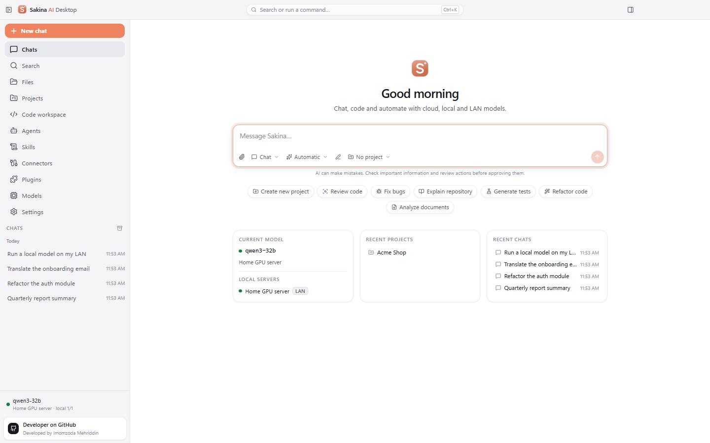 | 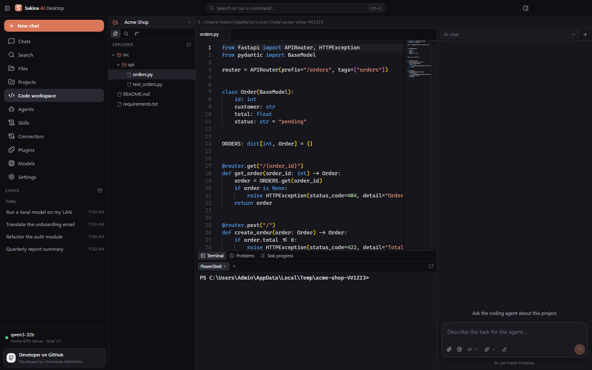 |
| **Главный экран** — светлая тема | **Рабочее место** — редактор, терминал, ИИ-агент |
| 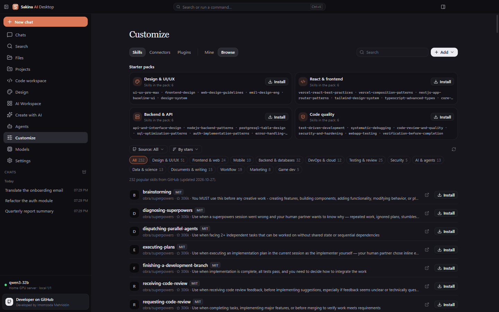 | 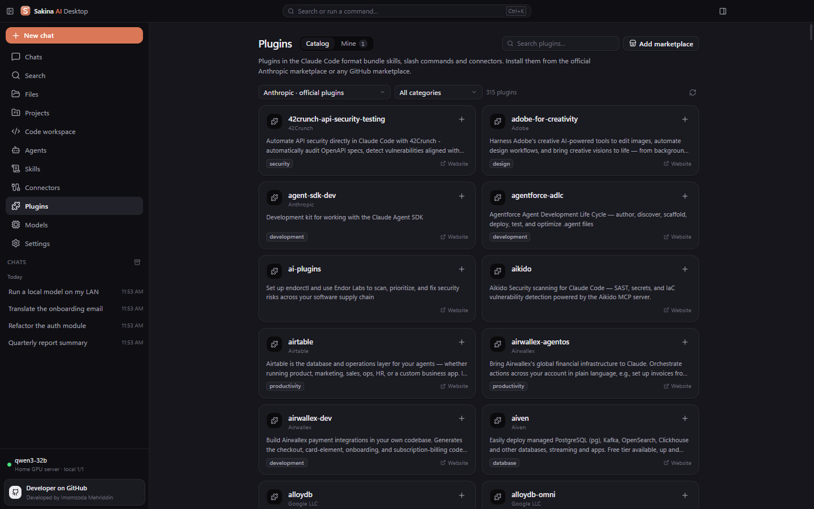 |
| **Каталог навыков** — 232 навыка, категории и наборы | **Плагины** — маркетплейс Anthropic |
| 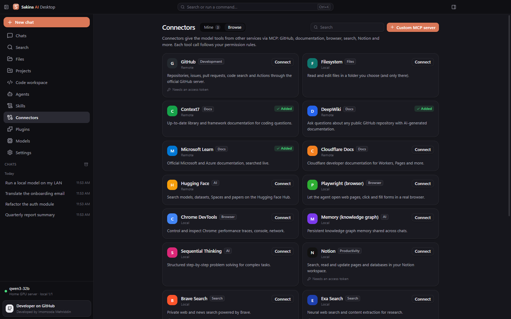 | 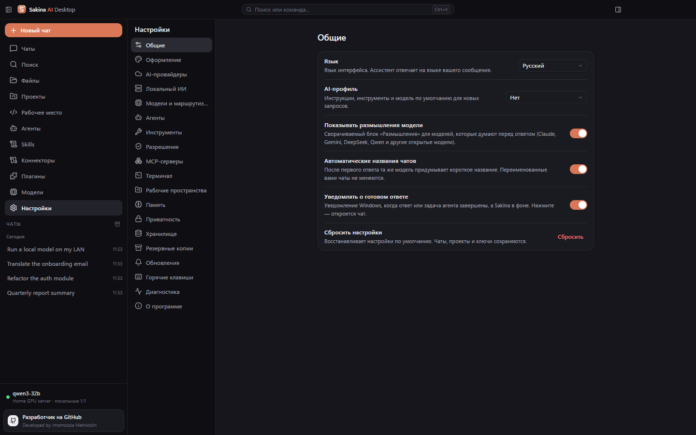 |
| **Коннекторы** — MCP в один клик | **Три языка** — русский, английский, таджикский |

## Установка

1. Скачайте **`Sakina-AI-Desktop-Setup-<версия>.exe`** из [последнего релиза](https://github.com/imomzoda-dev/SakinaAiDesktop/releases/latest).
2. Запустите и следуйте мастеру (установка для себя или для всех пользователей, выбор папки).
3. Windows SmartScreen может предупредить, потому что установщик пока не подписан сертификатом: нажмите **Подробнее → Выполнить в любом случае**.

**Требования:** Windows 10 или 11 (x64), 4 ГБ ОЗУ (рекомендуется от 8 ГБ), около 500 МБ на диске. Node.js нужен только для локальных MCP-коннекторов (npx).

### Обновление

Sakina проверяет GitHub Releases при запуске и каждые 4 часа (отключается в *Настройки → Обновления*). Когда выходит новая версия, в сайдбаре плавно появляется карточка: **GitHub** открывает описание релиза, **Обновить** скачивает его с прогрессом, проверяет SHA-512 и предлагает **Перезапустить и обновить**. Можно обновиться и вручную — новый установщик покажет «Обновление 1.x → 1.y» вместо «Установить» и сохранит чаты, проекты, настройки и ключи.

| | | |
|---|---|---|
| 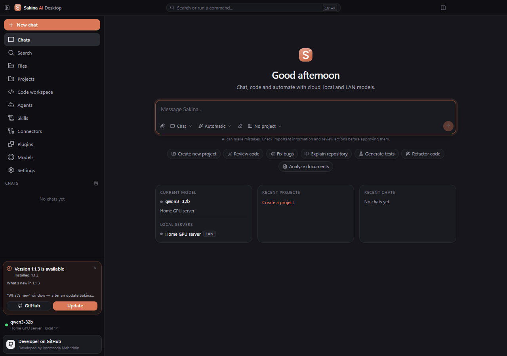 | 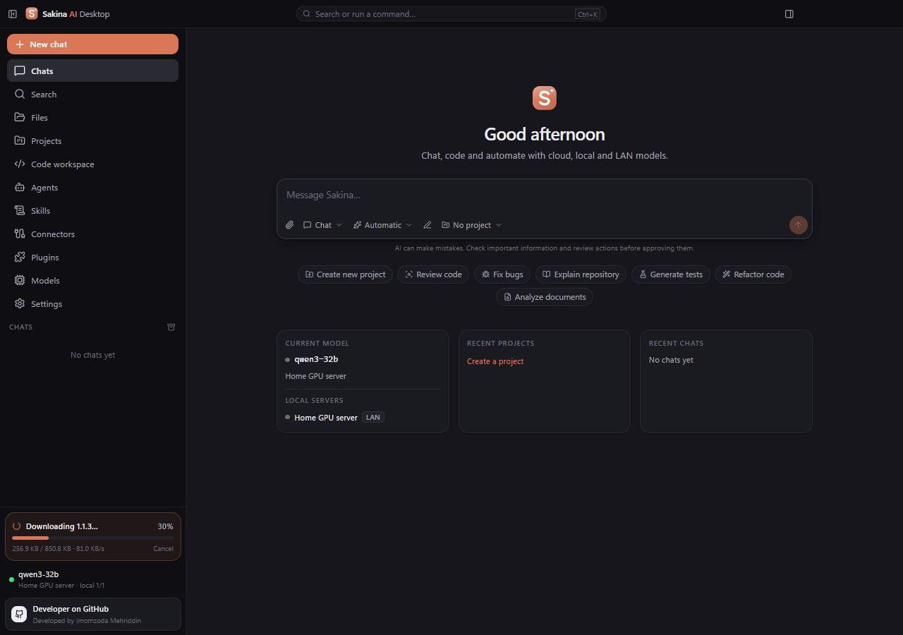 | 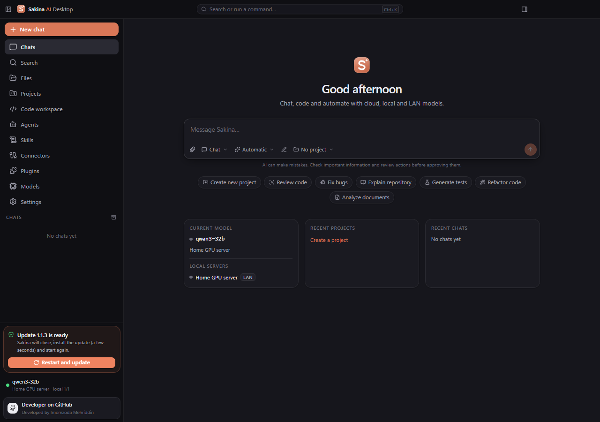 |
| **Найдена новая версия** | **Загрузка** | **Готово к перезапуску** |

## Своя модель на другом компьютере

```bash
# На компьютере с видеокартой (пример для Ollama): слушать локальную сеть
setx OLLAMA_HOST 0.0.0.0
ollama serve
```

В Sakina: **Модели → Локальный ИИ → Добавить локальный сервер**, выберите тип (Ollama, Open WebUI, vLLM, SGLang, LM Studio, Kimi K2…), укажите IP и нажмите **Проверить**. Если по адресу работает другой сервер (например, страница Open WebUI вместо её API), проверка это распознает и предложит **Применить**.

## Приватность

- Без телеметрии, аккаунтов и рекламы.
- Данные хранятся в `%APPDATA%\sakina-ai-desktop` на вашем компьютере.
- Запросы уходят только выбранным вами провайдерам и коннекторам; проверка обновлений обращается к GitHub.
- Ключи API и токены коннекторов зашифрованы Windows DPAPI и не попадают в журналы и экспорт.

## Лицензия

Sakina AI Desktop — бесплатная проприетарная программа, см. [лицензионное соглашение](LICENSE.md). Компоненты с открытым кодом используются по их собственным лицензиям (они включены в программу).

## Автор

Разработчик — **Imomzoda Mehriddin** · [github.com/imomzoda-dev](https://github.com/imomzoda-dev)

Нашли ошибку или есть идея? [Создайте issue](https://github.com/imomzoda-dev/SakinaAiDesktop/issues).
